# 1. Título do projeto

**Permission SaaS — Front-end em React** (repositório `permission_saas_front`).

# 2. Objetivo do projeto

O Permission SaaS é um sistema de gerenciamento de permissões por projeto. Um cliente cadastra os seus
projetos e, em cada um, os cargos e as rotas que cada cargo pode acessar. Sistemas externos consultam a
API para saber se uma requisição pode acessar uma rota com um cargo.

Ele é o projeto que uso em todas as disciplinas da pós-graduação: cada disciplina evolui o mesmo
sistema em vez de começar do zero. Até aqui, o sistema só tinha o back-end, em Java com Spring Boot.
**Esta disciplina criou o front-end**: uma aplicação React que consome a API principal
(`permission-service`) e oferece o CRUD completo de projetos, com login e rotas privadas.

O problema que a aplicação resolve é dar uma interface ao cadastro de projetos, que antes só podia ser
feito por ferramentas como o Postman: listar e buscar os projetos, ver o detalhe, criar, editar e
excluir, com validação e mensagens claras em cada etapa.

**API usada.** O enunciado da Feature III pede a integração com uma API externa. Em 07/10/2026, o
professor autorizou usar a API do próprio sistema (`permission-service`) para cumprir esse requisito,
sem uma API de terceiros.

# 3. Features implementadas

## Feature I — JavaScript moderno e interface com React

- **CRUD de projetos:** a lista com busca por nome e filtro de status, o detalhe, a criação, a edição
  e a exclusão.
- **JavaScript moderno:**
  - **arrow functions** em todos os handlers e funções auxiliares;
  - **destructuring** nas props e nos retornos dos hooks;
  - **spread** para atualizar o state sem alterá-lo;
  - **módulos** separando a lógica da interface;
  - **template literals**, por exemplo na mensagem de confirmação da exclusão: _Tem certeza que deseja
    excluir o projeto: "Loja Virtual"?_
- **Componentes reutilizáveis**, recebendo os dados por props:
  - `Card` e as suas partes;
  - `Button` e `LinkButton`, com variantes;
  - `Modal`;
  - `ProjectCard` e `ProjectStatusBadge`;
  - um único `ProjectForm`, usado na criação e na edição.
- **Estilos:** Tailwind CSS em todos os componentes e os ícones da biblioteca Phosphor Icons.

## Feature II — Dados, reatividade e listas

- **Props e state, com renderização condicional:** cada tela mostra o carregamento, o erro, a lista
  vazia ou os dados, e cada ação mostra um aviso de sucesso ou de erro.
- **Hooks personalizados:**
  - `useForm`, que guarda os valores e os erros de um formulário, valida no envio e apaga o erro do
    campo quando a pessoa volta a digitar;
  - `useDebounce`, que atrasa a busca por nome até a pessoa parar de digitar.
- **`useEffect`:**
  - no `useDebounce`, com a função de limpeza do timer;
  - no tempo de vida de cada aviso;
  - na abertura do `Modal`, que usa o `<dialog>` nativo do HTML.
- **Context API:** o `NotificationContext` entrega a qualquer componente os comandos de aviso na tela
  (`notify` e `dismiss`), sem passar props por vários níveis.
- **Formulários:**
  - **controlado:** o de projeto, pelo `useForm`;
  - **não controlado:** o de login, que lê os campos pelo `FormData` só no envio.

  Os dois validam antes de chamar a API.

- **Promises** em todas as chamadas à API, com `async`/`await` e tratamento de erro.

## Feature III — APIs e navegação

- **Fetch API, com um cliente próprio (`httpClient`)** para o GET, o POST, o PUT e o DELETE. Ele:
  - junta o prefixo `/api` e o JSON;
  - aplica o **timeout com `Promise.race`**;
  - cancela a requisição com o **`AbortController`**, combinando o próprio sinal com o de quem chamou
    (`AbortSignal.any`);
  - converte qualquer falha num `HttpError`, com o tipo do erro e o status HTTP.
- **Tratamento de erros:** cada tela decide a mensagem pelo tipo do erro e pelo status, sem mostrar a
  mensagem crua da API. Por exemplo:
  - um projeto excluído ou um endereço inválido mostram "Projeto não encontrado";
  - um 409 na edição avisa que o máximo de cargos é menor que os cargos que o projeto já tem.
- **React Query:**
  - o cache das buscas, com chaves por filtro;
  - a busca nova cancelada quando a pessoa continua digitando;
  - o cache invalidado depois de cada criação, edição e exclusão;
  - a resposta da edição gravada no cache antes de navegar.
- **React Router**, com as rotas da lista, do detalhe, da criação, da edição, do login e do 404.
- **Rota privada:** sem login, toda tela do app leva ao login, que anota a página pedida e devolve a
  pessoa a ela depois de entrar.
- **Componente de terceiros:** os ícones do Phosphor Icons nos botões, no cabeçalho e nos avisos.

## Gerenciamento de estado com Redux

A rubrica pede Redux, e as features não o citam. A sessão do login fica no Redux Toolkit:

- **O slice (`authSlice`):**
  - o estado guarda o usuário logado, ou `null`;
  - as ações `loggedIn` e `loggedOut`;
  - os selectors `selectCurrentUser` e `selectIsLoggedIn`.
- **A store**, no `app/store.ts`. A sessão é lida do `localStorage` ao criar a store e gravada fora do
  reducer, pelo `subscribe`, para sobreviver ao F5.
- **`useDispatch`** no login e no botão Sair.
- **`useSelector`** no cabeçalho, que mostra o nome, na rota privada e na tela de login.

O login é **simulado no front**: a API ainda não tem autenticação. O formulário compara o e-mail e a
senha com os de um usuário de demonstração (`demo@example.com` e `demo@123`), e a senha nunca entra na
store. Por isso, a rota privada organiza a navegação, mas não protege os dados: a API continua
aceitando chamadas diretas.

**O fluxo de dados**, do clique em Entrar ao nome no cabeçalho:

1. O formulário entrega a ação `loggedIn`, com o usuário, pelo `dispatch`.
2. O reducer calcula o estado novo.
3. A store avisa os `useSelector` inscritos.
4. O `selectCurrentUser` do cabeçalho passa de `null` para o usuário, e o cabeçalho renderiza de novo
   com o nome.
5. O `selectIsLoggedIn` da tela de login passa a `true`, e ela leva a pessoa à página que tinha
   pedido.

Nenhum componente manda navegar depois do `dispatch`: a tela reage ao estado. O Sair funciona do mesmo
jeito: entrega o `loggedOut`, e a rota privada leva ao login.

# 4. Tecnologias utilizadas

| Tecnologia                  | Versão     | Para quê                                                    |
| --------------------------- | ---------- | ----------------------------------------------------------- |
| React                       | 19.2       | a interface, com componentes funcionais e um de classe      |
| TypeScript                  | 6.0        | os tipos de todo o código                                   |
| Vite                        | 8.3        | o servidor de desenvolvimento, o build e o proxy para a API |
| Tailwind CSS                | 4.3        | os estilos                                                  |
| React Router                | 8.4        | as rotas, no modo declarativo                               |
| TanStack React Query        | 5.105      | o cache e a atualização dos dados da API                    |
| Redux Toolkit e React Redux | 2.14 e 9.3 | o estado global da sessão                                   |
| Phosphor Icons              | 2.1        | os ícones (componente de terceiros)                         |
| ESLint e Prettier           | 10 e 3.9   | a análise estática e a formatação                           |

O back-end consumido é o `permission-service`, em Java 21 e Spring Boot 4.1, com PostgreSQL, que
roda pelo Docker Compose.

**Por que Vite, e não o Create React App.** A rubrica pede o Create React App, mas o time do React o
descontinuou em 14/02/2025 e passou a recomendar outras ferramentas. Criei o projeto com o Vite, pelo
template oficial `react-ts`. A decisão está registrada como ADR-016 no log de decisões de arquitetura
do projeto (`docs/ARCHITECTURE.md` do repositório principal).

# 5. Instruções de execução

**Pré-requisitos:** Git, Docker com Docker Compose e Node.js 22.22 ou mais novo.

**1. Baixar o sistema**, com o front e o back-end como submódulos:

```bash
git clone --recurse-submodules https://github.com/Permission-SaaS/permission_saas.git
cd permission_saas
```

**2. Subir a API e os bancos** pelo Docker Compose, a partir da raiz:

```bash
cp .env.example .env
docker compose up -d --build
curl http://localhost:8080/ping      # responde "pong"
```

Se a porta 5432 já estiver ocupada por um PostgreSQL instalado na máquina, use
`POSTGRES_HOST_PORT=5434 docker compose up -d --build`.

**3. Cadastrar um cliente**, porque a criação de projetos precisa do id de um, e guardar o `id` da
resposta:

```bash
curl -X POST http://localhost:8080/clients/register \
  -H "Content-Type: application/json" \
  -d '{"name":"Demo","email":"demo@example.com","phone":"11999999999","rawPassword":"senha123","provider":"local","providerId":null}'
```

**4. Configurar e rodar o front:**

```bash
cd permission_saas_front
npm install
cp .env.example .env.local           # preencha VITE_DEV_CLIENT_ID com o id do passo 3
npm run dev                          # http://localhost:5173
```

**5. Entrar** com o usuário de demonstração, que a própria tela de login mostra: `demo@example.com` e
a senha `demo@123`.

Em desenvolvimento, o front chama `/api/...`, e o Vite repassa a chamada para `http://localhost:8080`.
O comando `npm run check` confere os tipos, o lint e a formatação.

# 6. Link do repositório GitHub

- **Front-end (o código desta disciplina):** <https://github.com/Permission-SaaS/permission_saas_front>
- **Repositório principal**, com o back-end, o Docker Compose, o log de decisões de arquitetura e o
  plano desta disciplina: <https://github.com/Permission-SaaS/permission_saas>

O plano da disciplina, com o cronograma, as decisões e o registro completo do uso de IA, está em
`docs/desenvolvimento_de_aplicacoes_interativas_com_react/PLAN.md` do repositório principal. As
convenções de código do front estão no `docs/ARCHITECTURE.md` do `permission_saas_front`.

Os pontos do código cujo porquê não é óbvio têm comentários curtos:

- o timeout e o cancelamento no `httpClient`;
- a gravação da sessão no `app/store.ts`;
- a página anotada pela `PrivateRoute`;
- o erro apagado ao digitar no `useForm`;
- o motivo de o `ErrorBoundary` ser uma classe.

# 7. Screenshots

## Login e rota privada

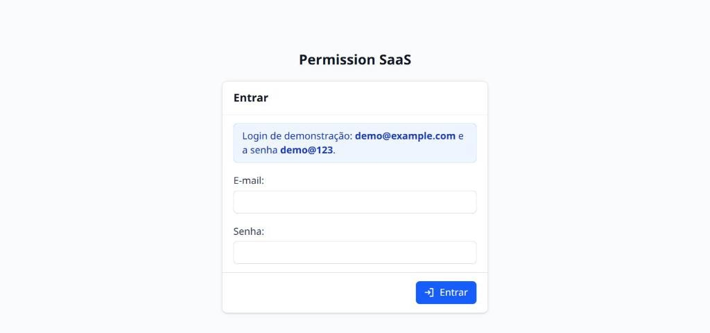

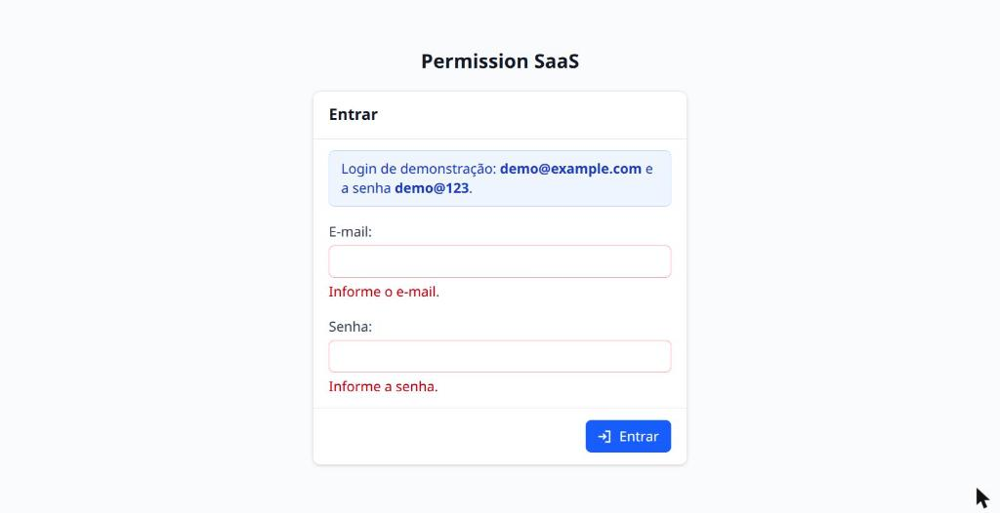

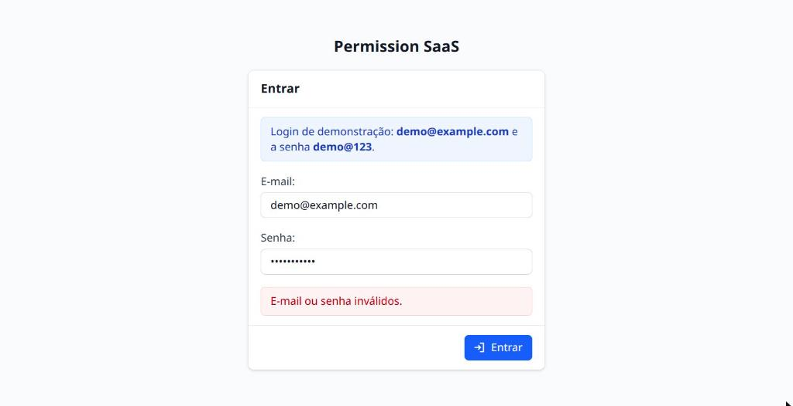

## Lista, busca e detalhe

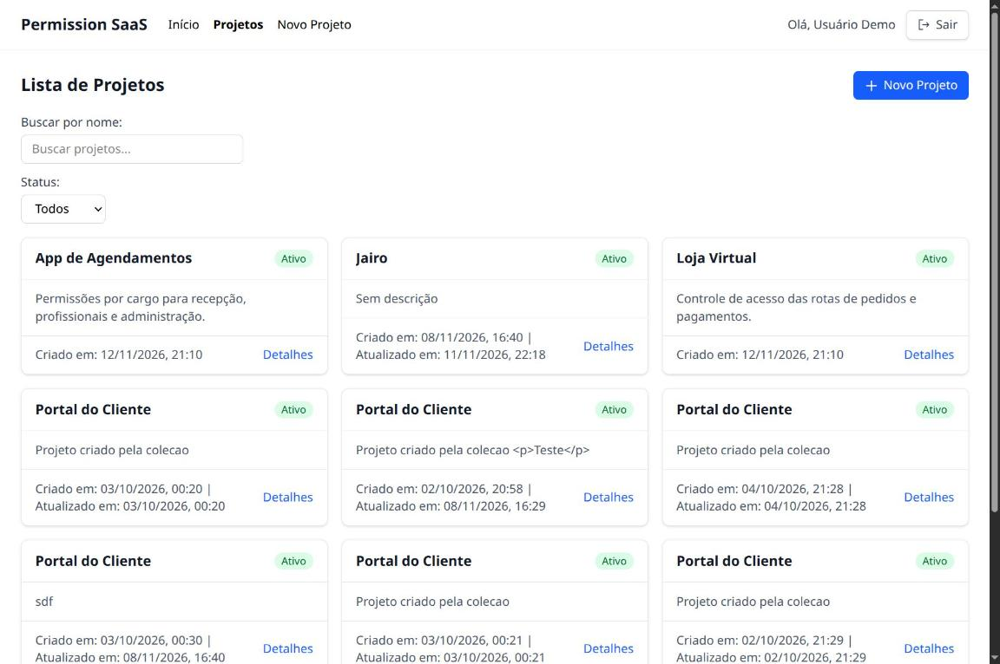

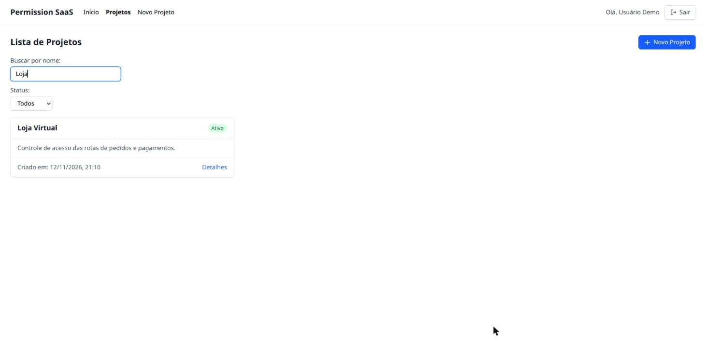

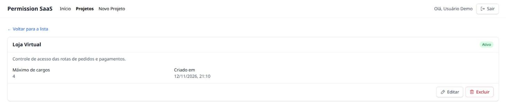

## Criação e edição

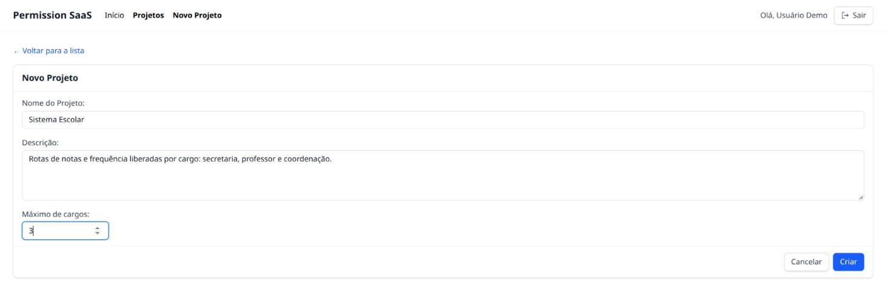

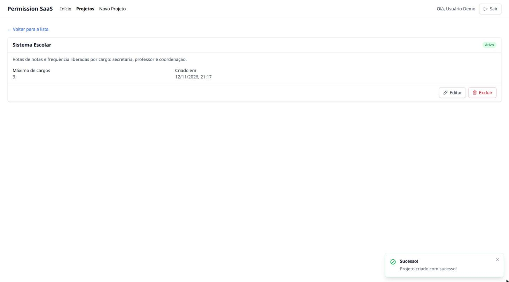

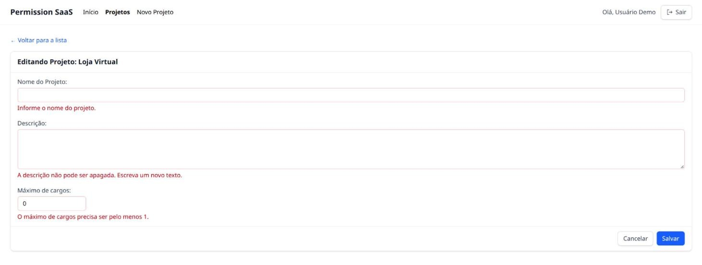

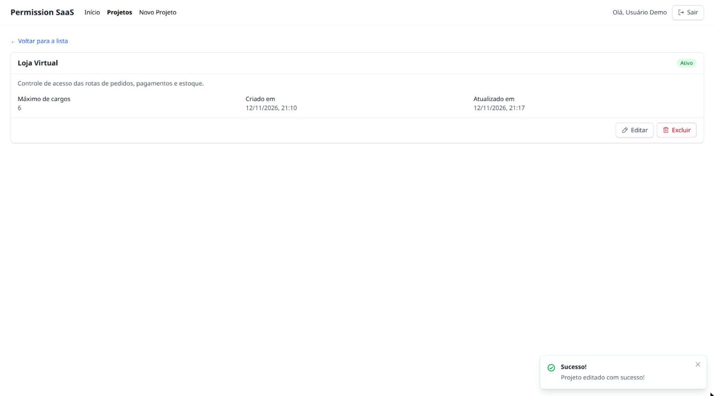

## Exclusão

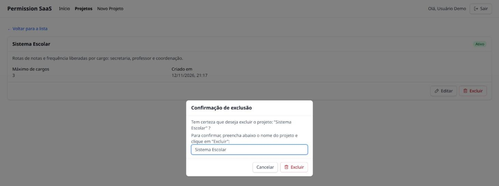

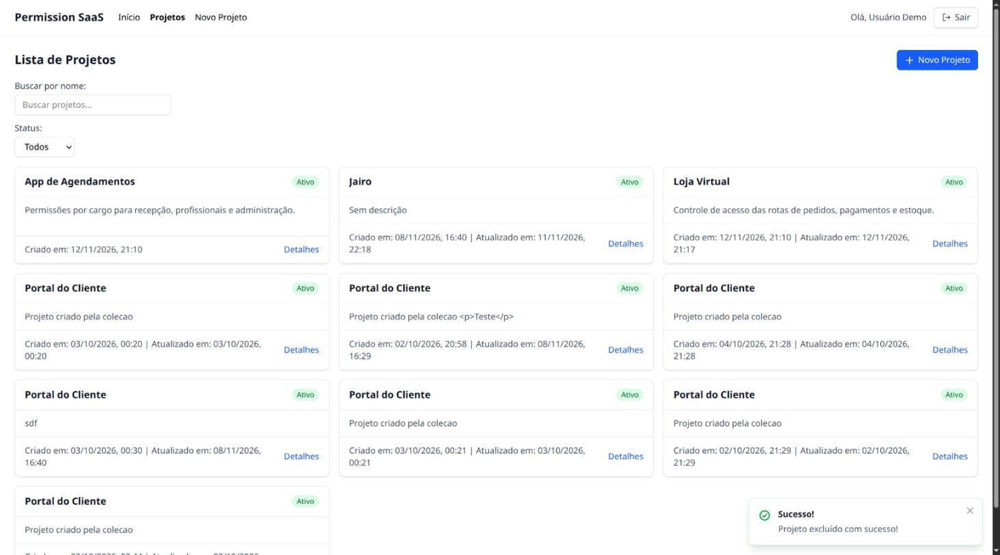

## Tratamento de erros

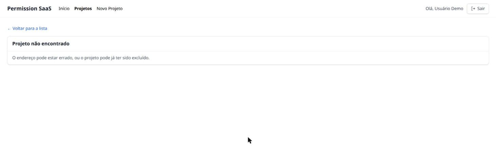

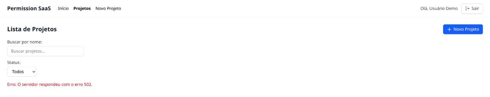

## Testes em navegadores

Rodei o mesmo roteiro de 12 passos nos três navegadores, no Linux, contra a API no Docker Compose:

1. sem login, a lista leva ao login;
2. o login com os campos vazios mostra os erros;
3. a senha errada mostra a mensagem geral;
4. o login certo leva à lista, com o nome no cabeçalho;
5. a criação com campos inválidos mostra os erros;
6. a criação válida leva ao detalhe, com o aviso de sucesso;
7. a busca por nome encontra o projeto criado;
8. a edição salva e mostra o nome novo;
9. um id inválido mostra "Projeto não encontrado";
10. o F5 mantém a sessão;
11. a exclusão confirmada pelo nome volta à lista, com o aviso;
12. o Sair leva ao login, e o F5 mantém a pessoa fora.

| Navegador       | Versão        | Resultado       |
| --------------- | ------------- | --------------- |
| Google Chrome   | 157.0.8103.50 | 12 de 12 passos |
| Mozilla Firefox | 156.0.1       | 12 de 12 passos |
| Microsoft Edge  | 157.0.4341.46 | 12 de 12 passos |

O roteiro rodou automatizado nos três, com os navegadores sem janela, controlados pelos protocolos de
automação de cada um (Chrome DevTools Protocol no Chrome e no Edge, WebDriver BiDi no Firefox). No
Chrome, também percorri as telas à mão, o que gerou os prints acima. Não houve diferença de
comportamento nem de layout entre os três.

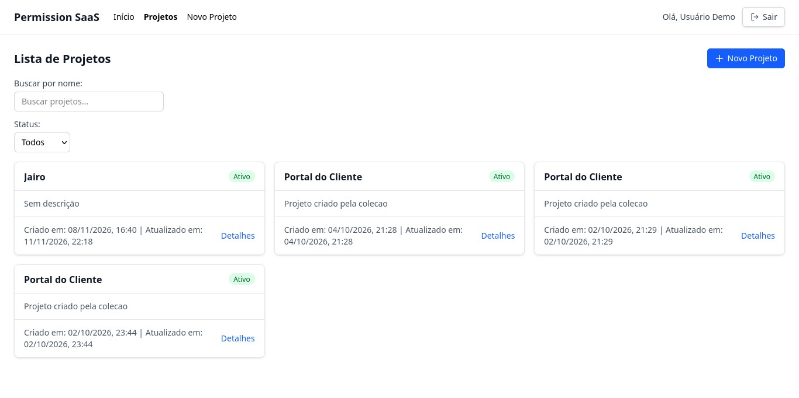

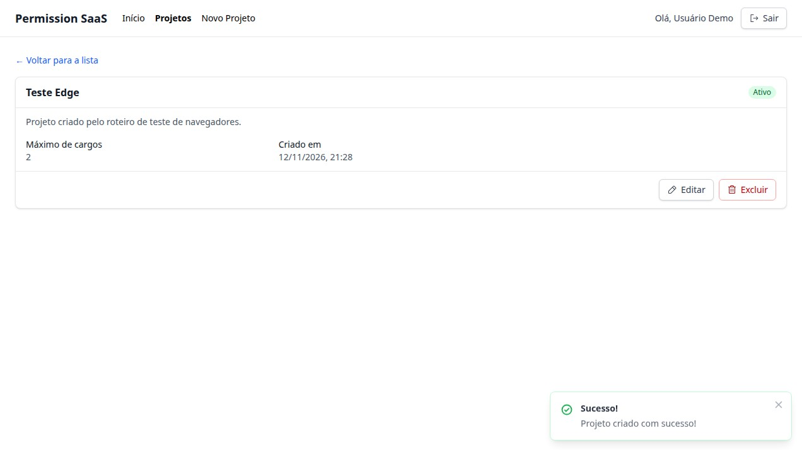

# 8. Considerações finais

**O processo.** Eu já tinha estudado React havia bastante tempo e queria reaprender até conseguir
construir sozinho. Por isso, cada passo seguiu o mesmo ciclo:

1. o conceito, com um exemplo pequeno fora do projeto;
2. a implementação no projeto;
3. a revisão do código;
4. experimentos em que eu escrevia a previsão antes de rodar.

O ciclo tomou mais tempo do que o planejado: a base, com o modelo de render, as rotas, o error
boundary, a Context API e o cliente HTTP, levou 18 dias no lugar de 4. Mas ele deixou os blocos
seguintes mais rápidos.

**Os desafios.**

- **O modelo mental do React:** o que dispara um render, por que o state precisa ser um objeto novo e
  por que o valor inicial do `useState` só vale na montagem. Esse último ponto apareceu na prática na
  edição: o formulário mostrava dados antigos do cache, e a correção foi gravar a resposta da API no
  cache antes de navegar.
- **O cache do React Query:** a diferença entre o dado do servidor e o estado do formulário, e quando
  invalidar o cache.
- **O Redux**, que eu nunca tinha usado a fundo. Entender que o reducer só calcula o estado novo, e
  que a gravação no `localStorage` precisa ficar fora dele, foi a parte mais importante.
- **O prazo.** No replanejamento de 28/10, cortei a autenticação JWT no back-end e a tela de cadastro.
  O login ficou simulado no front, e o Redux e a rota privada continuaram.

**Os aprendizados.** Cada ferramenta de estado resolve um problema diferente:

- o React Query guarda os dados da API;
- o Redux guarda o estado global do próprio front, que muda por eventos com nome;
- a Context API entrega um valor para a árvore de componentes.

Também aprendi a decidir entre formulário controlado e não controlado pela pergunta "preciso do valor
antes do envio?". E aprendi que uma rota privada no front organiza a navegação, mas só a API protege
os dados.

**Trabalho futuro:**

- a autenticação com JWT, que tornaria o login e a rota privada reais;
- o React Hook Form com o Zod, no lugar do `useForm` próprio;
- o Axios, no lugar do `httpClient` próprio;
- o shadcn/ui como biblioteca de componentes;
- sincronizar o logout entre abas pelo evento `storage`;
- permitir na API apagar a descrição de um projeto na edição.

Escrever à mão o `useForm`, o `httpClient` e o error boundary teve um objetivo didático: entender o
que essas bibliotecas fazem por dentro antes de adotá-las.

# 9. Créditos

## Uso de inteligência artificial

Usei o **Claude Code** (Anthropic) dentro da política de IA da disciplina (sinal amarelo). Os usos
foram estes:

- **Explicação de conceitos,** com analogias e exemplos fora do projeto: o modelo de render, o React
  Router, os error boundaries, a Context API, o `fetch`, o `AbortController` e o `Promise.race`, o
  React Query, os formulários controlados e não controlados e o Redux.
- **Revisão do meu código,** apontando bugs concretos e o porquê de cada um, e revisão das minhas
  previsões e respostas nos experimentos.
- **Trechos pontuais de código,** sempre registrados:
  - a parte estrutural, por uma divisão combinada em 28/10 para caber no prazo: os tipos das
    respostas da API, as funções de chamada, as chaves do cache, o `QueryClient` e a store do Redux;
  - a pedido, peças como os componentes visuais do `shared`, as regras de validação, o JSX de alguns
    formulários e os estilos.
- **Diagnóstico de requisições,** com `curl` e um Chrome sem tela, para conferir o contrato da API e o
  comportamento das telas, e o roteiro automatizado dos testes no Firefox e no Edge.
- **Organização e documentação:** o plano da disciplina, as convenções de código do front, os prints
  deste relatório e o rascunho deste texto, que revisei.

A lógica que a rubrica avalia ficou comigo, salvo os trechos registrados no plano. Isso inclui:

- os componentes e as páginas;
- os hooks;
- o `httpClient`;
- o slice do Redux e a rota privada;
- as decisões de escopo e de arquitetura.

O registro completo, por data, com o que a IA fez e o que foi meu, está na seção "Uso de IA" do
`PLAN.md` da disciplina.

## Fontes

- Documentação do React: <https://react.dev>
- Documentação do Redux Toolkit e o guia de estilo do Redux: <https://redux-toolkit.js.org> e
  <https://redux.js.org/style-guide>
- Documentação do TanStack Query: <https://tanstack.com/query>
- Documentação do React Router: <https://reactrouter.com>
- Documentação do Vite e do Tailwind CSS: <https://vite.dev> e <https://tailwindcss.com>
- Phosphor Icons: <https://phosphoricons.com>
- MDN Web Docs (`fetch`, `AbortController`, `Promise.race`, `FormData` e `<dialog>`):
  <https://developer.mozilla.org>
- Material e aulas da disciplina.
